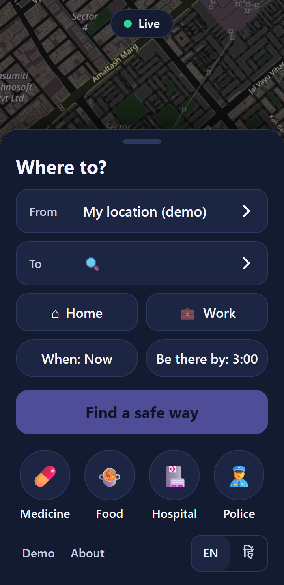
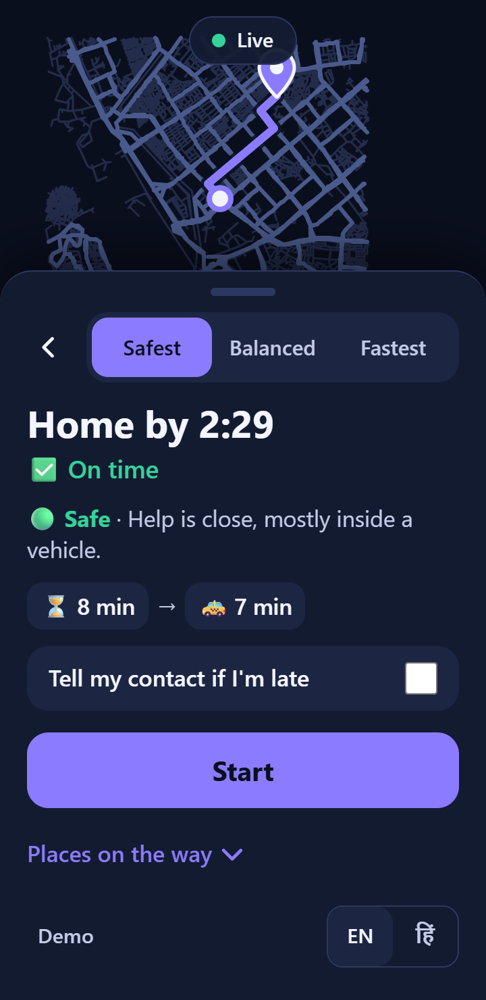
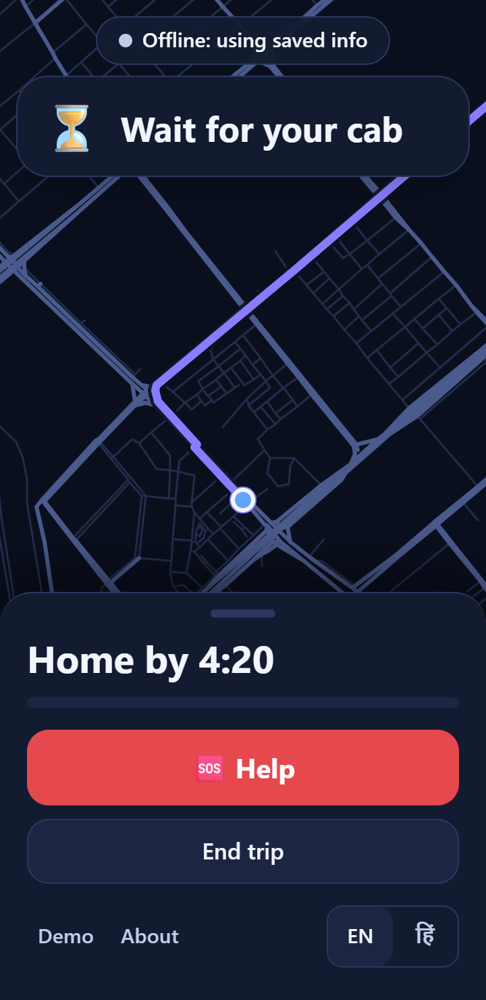
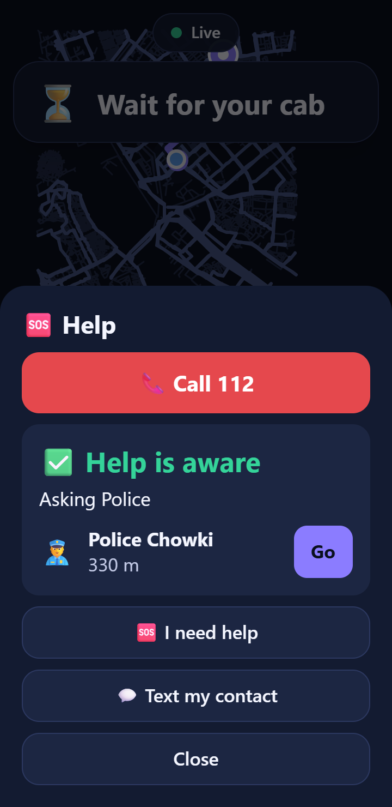
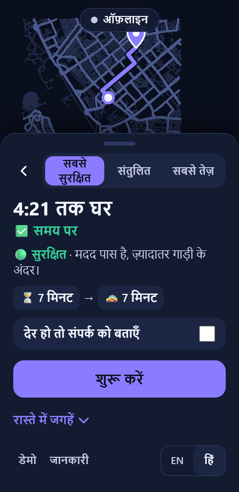

# NightWay: a safe way home at night (Android)

**CASCADE '26 · Problem 1.1 "The City That Sleeps While You Work"**

A night-shift worker finishes at 2:15 AM and has to be home by 3:00. NightWay shows **one safe way home**, says plainly whether it will be **on time**, and **keeps checking** while they travel. That covers buses being cancelled, roads closing, rain and phone signal dropping. It works **with no internet**: the phone does all the thinking, on map data bundled in the app.

Its core rule: every fact the app uses is **Known, Probable, Outdated or Unknown**, and nothing is invented. Missing information makes the answer more careful (a wider time range, a warning, a Backup); it is never filled in.

| Home | Result | Trip, offline | Help | Hindi |
|---|---|---|---|---|
|  |  |  |  |  |

## What the user sees

- **Home**: From (GPS) / To (**Home**, **Work**), When, Be there by, then **Find a safe way**. Four quick buttons: Medicine, Food, Hospital, Police ("open now").
- **Result**: tabs Safest / Balanced / Fastest, "Home by 2:29", **On time / Could be late / Too late**, **Safe / OK / Be careful** with a short reason, and icon steps. If something important is unsure, one short warning ("Bus time is a guess.") and a **Backup** button.
- **Trip**: the next step in big text, a progress bar, one banner at a time ("Road ahead is closed. New way found."), and an always-visible red **Help** button.
- **Help**: **Call 112**, three big buttons (*I'm in danger*, *I need a doctor*, *Not sure*), **Text my contact** (SMS with a map link). Progress in plain words: *Sending… → Passed on → Help is aware*, or *Not sure*.
- **Safety timer**: "Tell my contact if I'm late" asks *Are you home?* 10 min after the deadline; no answer means an alert and a ready-to-send text.
- English and Hindi (EN | हिं). No engineering words anywhere in the normal screens: a test fails the build if one appears.

## Install and run

**On the phone**: the debug APK is `frontend/android/app/build/outputs/apk/debug/app-debug.apk`. Copy it to the phone and tap it to install. Allow "install unknown apps" for your file manager, and allow location when asked.

**Build it yourself** (Node 18+, JDK 17, Android SDK 34; see [ENVIRONMENT.md](ENVIRONMENT.md)):
```bash
cd frontend && npm install
bash ../scripts/build-apk.sh                    # runs the tests, builds the web app, syncs Capacitor, assembles the APK
powershell -ExecutionPolicy Bypass -File ../scripts/push-apk.ps1   # Windows: copy to the phone's Download folder over USB (no adb needed)
bash ../scripts/build-apk.sh --install          # or, with USB debugging on: adb install
```

**In Chrome** (fastest way to look around): `cd frontend && npm run dev`, then open http://localhost:5173 with a phone-sized window.

**Dispatch server for the Help demo** (simulated police / hospital / contact desks):
```bash
cd server && npm install && npm start           # prints http://<laptop Wi-Fi IP>:8787
```
In the app, open **Demo → 8. Dispatch server**, enter that address and press **Save + test**. Phone and laptop must share a Wi-Fi network; on Windows, allow Node.js through the firewall. The dashboard is at http://localhost:8787.

**Tests**: `cd frontend && npm test` runs 55 tests in about 15 s: freshness rules, opening hours, the planner on the real Nagpur data, the plain-words view, all 8 stress scenarios, copy rules, and the help ladder and mesh.

## How it works

```
frontend/src/
  engine/      TypeScript decision engine, runs in a Web Worker on the phone
    freshness.ts   Known / Probable / Outdated / Unknown, confidence decay, weakest-link aggregation
    sim/           seeded feeds (traffic, bus positions, closures, weather) with delays and dropouts; demo events
    planner.ts     walk / bus / cab candidates at several risk weights; best / expected / worst arrival; safety as a range
    replanner.ts   re-plans every tick, with hysteresis so the plan doesn't flip; logs every change with its reason
    simpleView.ts  the only thing the screens render: plain words, no numbers except times, minutes, metres
    scenarios.ts   8 deterministic stress scenarios (bus cancelled, road closed, all live info lost, ...)
  sos/         help ladder, dispatch client, simulated mesh, safety timer
  copy/        every word (en.ts, hi.ts) + the banned-word / length test
  theme.ts     every colour and size        config.ts   every threshold and weight
  data/        the city, built by tools/build_data.py (OSM + Open-Meteo), about 1.3 MB
server/        demo dispatch server (Node + Express, one file)
backend/       the original Python engine, kept as the reference (same 8 scenarios); not shipped
legacy/        replaced code and earlier specs (see AUDIT.md)
```

- **Offline first**: online the map shows OpenStreetMap streets in a night palette; offline it switches to the road network bundled in the app. Places and opening hours are bundled, and the weather forecast is a saved snapshot. With no signal, the app says **"Offline: using saved info"**, live information stops arriving, facts age (Known → Probable → Outdated → Unknown), and plans become more careful instead of breaking.
- **Live**: when online, a real Open-Meteo reading is fetched every 15 min; the pill shows **Live**.
- **Saved on the phone** (Capacitor Preferences): Home, Work, language, the last trip (a started trip carries on after a restart), the dispatch address.

## Real vs simulated

| Real | Simulated (marked `synthetic: true` in the code; only the Demo drawer says so) |
|---|---|
| Streets, footpaths, street lamps / `lit` tags (OpenStreetMap) | Traffic speeds |
| Hospitals, police, pharmacies, shops, opening hours (OpenStreetMap) | Live bus positions, cancellations |
| Bus-stop locations (OpenStreetMap) | Bus timetable (until U4: estimated, no open feed found yet) |
| Weather forecast snapshot + live current weather (Open-Meteo) | Road closures, accidents, waterlogging |
| Phone GPS, SMS and phone calls (the user sends them) | Incident history (seeded, biased by real map features) |
| | Cab waiting times |
| | Police / hospital / contact desks (`server/`), mesh of nearby phones |

**Help is a demo**: the dispatch server is not connected to any emergency service. *Call 112* is the real path and is always on screen. Area: Nagpur and Butibori (Nagpur core, Butibori + IIIT Nagpur, and the Wardha Road corridor).

## Honest limits

- The safety score is a careful estimate from open data. About 97 % of street length has no lighting information, so the app never calls a street lit unless the map says so; unknown lighting only widens the safety range.
- Cab routes ignore one-way streets (small error on a 4 km area); transfers between buses are not planned.
- The mesh is a simulation of 6 phones. Real Bluetooth relaying (Phase 7) is off and not verified.
- Hindi copy was written for this build and should be reviewed by a native speaker before real users see it.

More: [DEMO.md](DEMO.md) (3-minute demo script), [ASSUMPTIONS.md](ASSUMPTIONS.md) (every decision and why), [PROGRESS.md](PROGRESS.md), [AUDIT.md](AUDIT.md).

Map data © OpenStreetMap contributors (ODbL). Weather data by Open-Meteo.com (CC BY 4.0).
