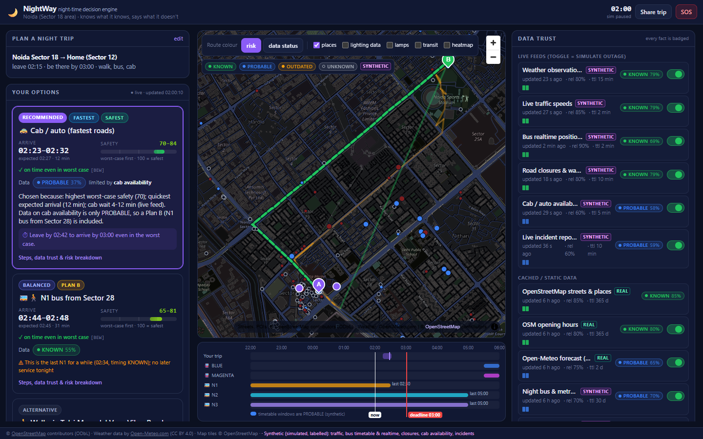

# NightWay: a night-time decision engine

**CASCADE '26 · Problem 1.1 "The City That Sleeps While You Work"**

A night-shift worker says *"I finish at 2:15 AM and need to be home by 3:00."* NightWay returns the safest **feasible** plans (walk, night bus, cab), each with an arrival **range**, a safety **range**, best/expected/worst-case deadline checks, a Plan B and a one-line reason. It then **keeps re-planning** as data ages, feeds die, it rains or a road closes.

Its core rule: **every fact is KNOWN, PROBABLE, OUTDATED or UNKNOWN, and nothing is ever invented.** Missing data widens ranges and triggers Plan B; it is never filled in.



## Quick start

Prerequisites: Python 3.11+ and Node 18+. The cached city data for Noida is in `data/`, so **no internet is needed** to run.

**Backend** (http://localhost:8000):
```bash
cd backend
python -m venv .venv && .venv/Scripts/pip install -r requirements.txt     # macOS/Linux: .venv/bin/pip
.venv/Scripts/python -m uvicorn app.main:app --port 8000                 # one command after install
```

**Frontend** (http://localhost:5173, proxies `/api` to :8000):
```bash
cd frontend
npm install && npm run dev
```

**Single port (for the demo machine):** run `npm run build` in `frontend/` once; the backend then serves the UI at http://localhost:8000 (the scenario results page is at `/scenarios`).

**Tests and stress harness:**
```bash
cd backend && .venv/Scripts/python -m pytest -q          # 32 tests, ~3 s (freshness, hours, risk, planner)
.venv/Scripts/python ../scripts/run_scenarios.py         # 8 deterministic scenarios + results table
```

Optional: copy `.env.example` to `.env` and set `GROQ_API_KEY` to enable LLM parsing of free text. Without it, the rule parser handles the same sentences.

## What judges should look at

| Feature | Where |
|---|---|
| KNOWN / PROBABLE / OUTDATED / UNKNOWN on every fact | Badges everywhere; hover a route segment on the map |
| Data Trust panel (signature feature) | Right column: every source with status, age, reliability, REAL/SYNTHETIC tag, status strip and an outage toggle |
| Graceful degradation | Simulation → *Kill traffic + bus realtime*, then *Kill ALL live data*, then *+15 min* |
| Never inventing | Pharmacies without OSM hours show **UNKNOWN, hours unknown**, never "open"; the validator checks every output |
| Ranges, not numbers | ETA `02:23–02:41`, safety `68–84`, risk breakdown bars |
| Continuous re-planning with hysteresis | Change log: *"Kept current plan; … below the hysteresis threshold"* / *"Current plan broke (cab route crosses a closure (Amaltash Marg))"* |
| Stress harness | `/scenarios` page or `scripts/run_scenarios.py`: 8/8 pass, 0 invalid outputs |

See [DEMO.md](DEMO.md) for the 5-minute demo script.

## How it works

```mermaid
flowchart LR
  subgraph Cache["data/ (downloaded once, offline at runtime)"]
    OSM["OSM walk + drive graphs<br/>(OSMnx packs)"]
    POI["OSM POIs + opening hours<br/>(Overpass, with edit dates)"]
    WX["Open-Meteo forecast"]
    TT["Night timetable<br/>(synthetic, real stop locations)"]
    INC["Incident history<br/>(synthetic, seeded)"]
  end
  subgraph Sim["Simulator (ground truth, hidden from planner)"]
    TRUTH["Truth: rain, closures,<br/>cancellations, delays"]
    FEEDS["Feed simulator<br/>delays · dropouts · outages"]
  end
  TRUTH --> FEEDS
  FEEDS -->|"Facts (observed)"| STORE[("Fact store")]
  Cache -->|"Facts (observed / scheduled / inferred / prior)"| STORE
  STORE --> FRESH["Freshness engine<br/>status + confidence decay"]
  FRESH --> RISK["Risk scorer<br/>6 components as [lo, hi]"]
  FRESH --> PLAN["Planner<br/>candidates → forward-in-time eval<br/>→ robust selection + Plan B"]
  RISK --> PLAN
  PLAN --> REPLAN["Re-planner<br/>hysteresis + change log"]
  CLOCK["Sim clock"] --> FEEDS & REPLAN
  REPLAN -->|"SSE plan_update"| UI["React UI<br/>map · cards · trust panel · timeline"]
  FRESH -->|"/api/trust"| UI
  VAL["Validator: UNKNOWN never carries a value"] -.-> PLAN
```



1. **Facts.** Everything the planner uses is a `Fact {value, source, synthetic, observed_at, ttl_s, reliability, kind}` ([facts.py](backend/app/core/facts.py)).
2. **Freshness.** `status(fact, now)` applies SPEC §5: observed and fresh = KNOWN; stale ≤ 3×TTL, timetable, inference or prior = PROBABLE; older or contradicted = OUTDATED; missing or > 10×TTL = **UNKNOWN, value stripped** ([freshness.py](backend/app/core/freshness.py)). Confidence decays smoothly. Aggregation is weakest-link status plus a confidence product.
3. **Risk.** Lighting, incidents, isolation, traffic/closures, weather and emergency access are each an interval per street edge. UNKNOWN inputs add **width**, not a value. For example, unknown lighting is `[0.25, 0.9]`, and unknown weather is `[0, 0.7]` ([risk.py](backend/app/core/risk.py)).
4. **Planner.** It builds walk paths at several risk weights (λ), cab routes, and bus/metro options via board/alight stops, then simulates each **forward in time** as best/expected/worst triples. It picks from the worst-case-feasible pool by robust (worst-case) safety, labels Fastest/Safest/Balanced, and builds a Plan B that avoids the recommended plan's weakest dependency ([planner.py](backend/app/core/planner.py)).
5. **Live loop.** Every tick the sim clock advances, feeds emit (or don't), facts age, and every active plan is re-planned. The re-planner only switches with a reason (hysteresis) and logs every transition ([replanner.py](backend/app/core/replanner.py)).

## Data: what is real and what is synthetic

| Data | Source | Status in the app |
|---|---|---|
| Street network (walk 844 km, drive 1,205 km) | OpenStreetMap via OSMnx (real) | KNOWN (map) |
| Street lighting | OSM `lit` + street lamps (real, covers 2.5 %); main-road prior; otherwise unknown | KNOWN / PROBABLE / **UNKNOWN** |
| 371 facilities + opening hours | OSM via Overpass (real; hours on 35 of them) | KNOWN / PROBABLE (category prior) / OUTDATED (old tags) / **UNKNOWN** |
| Weather forecast | Open-Meteo (real, cached) | PROBABLE (forecast) |
| Live weather observations | simulated around the real forecast | **SYNTHETIC** |
| Night bus + metro timetable | hand-built on real OSM stop locations | **SYNTHETIC**, PROBABLE |
| Bus realtime, traffic speeds, closures, cab availability, incident reports | feed simulator | **SYNTHETIC** |
| Incident history | seeded generator biased by OSM proxies | **SYNTHETIC** |

Credits: © OpenStreetMap contributors (ODbL) · Weather data by Open-Meteo.com (CC BY 4.0) · map tiles © OpenStreetMap (light use).

**Switching city:** edit `city_name`, `center`, `radius_m` and the `personas` place names in [backend/config.yaml](backend/config.yaml), then run `backend/.venv/Scripts/pip install -r requirements-data.txt` and `python scripts/fetch_all.py` (Overpass + OSMnx + Open-Meteo, a few minutes).

## API

| Method | Path | Purpose |
|---|---|---|
| POST | `/api/plan` | Create a plan set `{origin, destination, finish_time, deadline, persona, prefs}` |
| GET | `/api/plan/{id}` · `/api/plan/{id}/stream` | Current plan set · SSE `plan_update` events with change log |
| POST | `/api/nl/parse` | Free text → structured request (Groq if keyed, rules otherwise) |
| GET | `/api/trust` | All sources: status, age, reliability, synthetic flag, history, coverage |
| POST | `/api/sim/outage` | `{source, enabled}` (`all_live`, `all`, or a source id) |
| POST | `/api/sim/clock` | `{speed, paused, time, advance_s}` |
| POST | `/api/sim/inject` | Ground-truth events: rain, fog, road_closure, accident, bus_cancelled, schedule_conflict, cab_shortage, incident |
| POST | `/api/sim/scenario/{id}/run` · `/api/scenarios/run_all` | Scenario replay |
| GET | `/api/need-now?type=pharmacy&lat=&lon=&time=` | Nearest place open on arrival, with safe route and confidence |
| GET | `/api/heatmap?hour=2` | Night safety grid (GeoJSON) |
| POST | `/api/sos` · `/api/share` | Simulated SOS / trusted-contact share |
| GET | `/api/health` | Liveness + data version |

## Repo layout

```
backend/
  app/main.py                FastAPI app + live loop (serves frontend/dist if built)
  app/api/routes.py          HTTP + SSE endpoints
  app/core/                  facts, freshness, clock, world (static data), state (live),
                             risk, services (open-now), planner, replanner, needs, heatmap,
                             nlp, validate, transit, cab, engine
  app/core/sim/              feeds (live feed simulator), events (injections), scenarios
  app/adapters/              osm (graph packs + routing), overpass (POIs), weather,
                             traffic_sim, incidents_sim, geo
  config.yaml                city, sources (TTL, reliability), risk weights, planner, personas
  tests/                     pytest on a synthetic 7x7 grid city
frontend/src/                React app (components/, api.ts, types.ts)
data/                        cached city data (compact, committed)
scenarios/                   8 scenario JSON files
scripts/                     fetch_*.py, build_transit.py, gen_incidents.py, fetch_all.py,
                             run_scenarios.py, record_demo.py
```

More detail: [ASSUMPTIONS.md](ASSUMPTIONS.md) (every judgement call), [SPEC.md](SPEC.md) (the brief), [DEMO.md](DEMO.md) (demo script).

## Troubleshooting

* **"Waiting for the engine…"** in the UI means the backend isn't running on :8000.
* **Map area is blank** means the browser has WebGL disabled. Everything else still works; enable hardware acceleration.
* **Overpass busy** when fetching a new city: the scripts retry with backoff across the mirrors in `config.yaml`.
* **The clock already says 03:00**: use *Reset simulation* in the Simulation panel. The clock starts paused at 02:00 and runs from the first plan.
